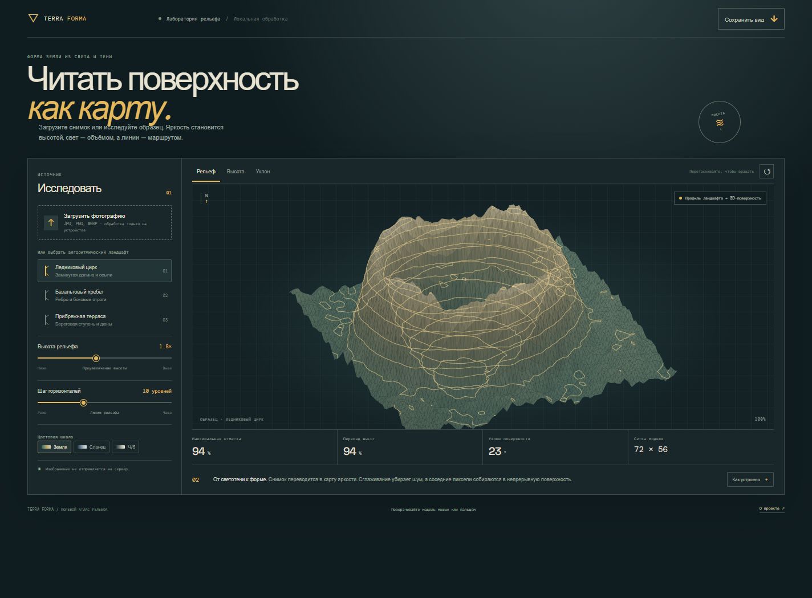

# Terra Forma

**Read the surface as a map.** Terra Forma turns a photograph's light and shadow into a relative height field, then renders it as a rotatable terrain model with elevation colors and contour lines.

## Русский

Terra Forma — браузерная лаборатория рельефа. Загрузите фотографию, и её яркость станет относительной высотой поверхности. Можно также исследовать три алгоритмических образца: ледниковый цирк, базальтовый хребет и прибрежную террасу.

### Возможности

- Создание высотной сетки 72 × 56 из локального изображения.
- Трёхмерный просмотр с вращением мышью или пальцем и масштабом колёсиком.
- Режимы рельефа, высот и уклонов.
- Настройка преувеличения высоты, числа горизонталей и цветовой шкалы.
- Сохранение текущего вида в PNG.
- Экспорт сетки высот в OBJ и чёрно-белой карты высот в PNG для быстрых 3D- и игровых блок-аутов.
- Фотография обрабатывается в браузере и не отправляется на сервер.

Значения высоты показаны в относительных единицах, так как фотографии не содержат данных об абсолютной высоте или масштабе. Это инструмент визуального исследования светотени, а не геодезическая съёмка.

### Запуск

Откройте `index.html` или запустите локальный статический сервер из этой папки.

## English

Terra Forma is a browser-based terrain lab. Upload a photograph and its brightness becomes a relative height field. You can also explore three algorithmic samples: a glacial cirque, a basalt ridge, and a coastal terrace.

### Features

- Build a 72 × 56 height grid from a local image.
- Rotate the terrain with a mouse or touch and zoom with the wheel.
- Switch between terrain, elevation, and slope views.
- Adjust vertical exaggeration, contour count, and color ramp.
- Save the current view as a PNG.
- Export the heightfield as an OBJ mesh or a grayscale PNG height map for quick 3D and game-level blockouts.
- The photograph is processed in the browser and is never uploaded.

Height values are relative because photographs do not contain absolute elevation or scale data. This is a visual study of light and shape, not a surveying instrument.

### Run

Open `index.html` or serve this directory with a local static web server.

## Design idea

Terra Forma borrows from a field atlas and a relief model on a surveyor's table. The dark backdrop makes contour lines and layered terrain colors readable, while the controls explain how the source image becomes a surface. The three sample forms make the generator useful before a photograph is selected.
